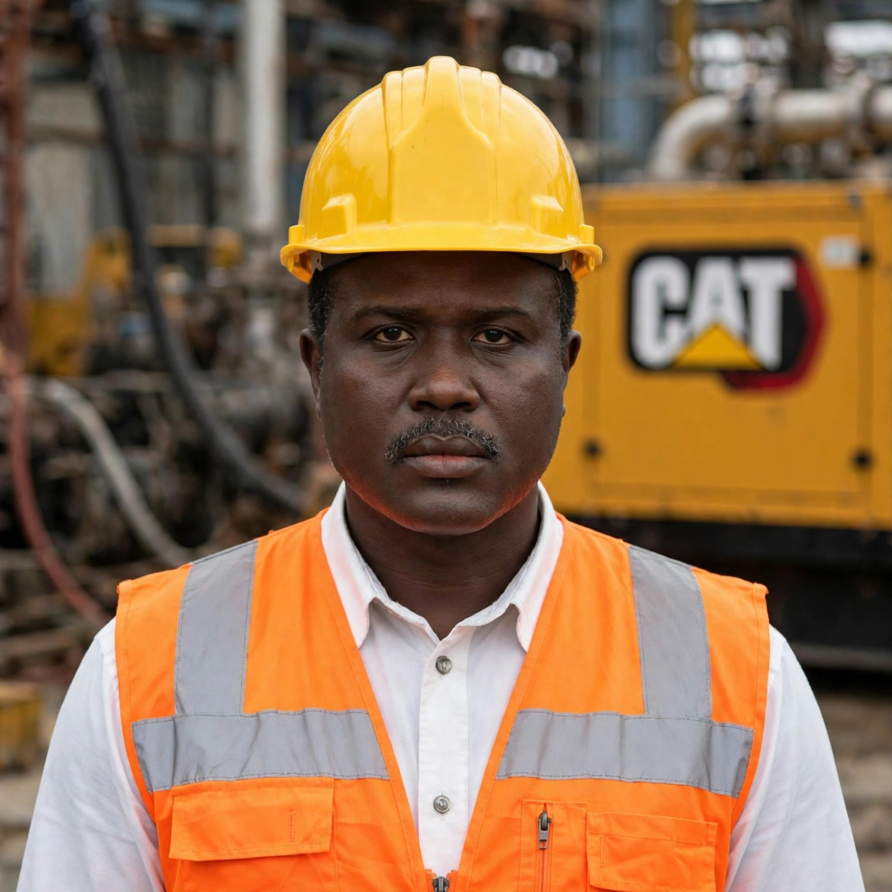

  

<h1 align="center">Osman A. | ATS Industrial Intelligence</h1>

  <b>🏭 20+ Years Field Engineer → Built AI from Omdurman for GCC Factories</b> 
  ⚡ CAT 3516C 3000kW | Perkins | Cummins | DSE 8610/7320 Sync Expert 
  <i>"I don't build apps. I build Industrial Operating Systems that save $50k/year in fuel & downtime."</i>

  
  
  

### 🔴 LIVE DEMO: ATS Industrial Intelligence Suite
**👉 https://ats-docgen-ai-mmvq4yws2dqhuwhzktrhw8.streamlit.app**
**🎁 Code: `TRIAL-7DAYS`**

> **هل مصنعك لا يزال يدير المولدات بالدفتر؟**

  

### ⚡ 4 Core Specialties:

**1. Power Generation:** CAT 3516C / C32 / Perkins 4000 Series / Cummins QSK / DSE 8610 & 7320 Sync
**2. Cold Chain:** Porkka Finland | Emerson | WIC Inspection | HACCP | SBC 601
**3. Fuel & Hybrid:** Real-time Fuel Consumption | Fuel Theft Detection | Solar + Genset
**4. Field AI:** RAG & Vector DB | Vision OCR | Acoustic Diagnostics | LSTM / RUL 72h Prediction | WhatsApp Work Orders

**📍 Omdurman, Sudan → KSA, UAE, Qatar**
**📲 WhatsApp:** +249922562846

#Perkins #CAT #Cummins #DSE8610 #PowerGeneration #PredictiveMaintenance #ColdChain #Porkka #السودان #ATS_ENG
